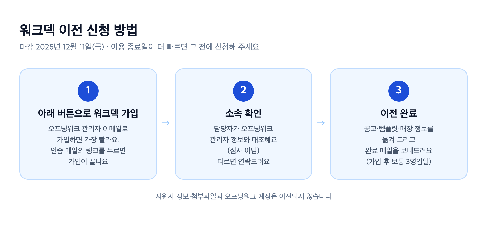

# 오프닝워크 서비스 종료 안내 (노션 공지용) — B안: 종료 + 워크덱 이전

> 노션 페이지에 그대로 붙여넣는 본문. 🟡 표시 값은 제안값이라 확정 후 표시를 지운다.
> 원본: `2026-10-29-opening-shutdown-notice-draft.md`
> 2026-11-04 사용자 지시: 토스 결제 이슈로 이전이 불가능할 수 있어 두 버전을 둔다. A안=`2026-10-30-opening-closing-notion-notice.md`, **B안(이 파일)=종료+워크덱 이전**. 토스 계약(라이브 결제 가능)이 공지 전에 끝났을 때만 쓴다.
> 코드: A안 opening_web `chore/closing-notice`·opening_api `chore/service-closing-block` / B안 `chore/closing-notice-migration`·`chore/service-closing-block-migration`.

---

# 오프닝워크 서비스 종료 안내

안녕하세요, 오프닝워크입니다.

그동안 오프닝워크를 이용해 주셔서 진심으로 감사드립니다.
오프닝워크는 **2026년 12월 18일(금)**에 서비스를 종료합니다.

## 주요 일정

| 일정                       | 내용                                                             |
| -------------------------- | ---------------------------------------------------------------- |
| 🟡 **2026년 11월 2일(월)** | 신규 가입과 신규 플랜 신청 중단                                  |
| **2026년 11월 18일(수)**   | 모든 구독의 자동 갱신 해지                                       |
| 고객별 **이용 종료일**     | 이미 결제하신 이용 기간이 끝나는 날 (11월 19일 ~ 12월 17일 사이) |
| **2026년 12월 18일(금)**   | 서비스 종료. 이후에는 로그인과 데이터 조회가 불가능합니다        |

- 이미 결제하신 이용 기간은 끝까지 이용하실 수 있습니다. **추가 결제와 환불은 없습니다.**
- 11월 18일 전에 결제일이 돌아오면 평소처럼 한 번 더 결제되며, 그 이용 기간은 12월 18일 전에 끝납니다.
- 고객님의 이용 종료일은 오프닝워크에 로그인하면 안내 팝업에서 확인하실 수 있습니다.

## 종료 전에 꼭 해주세요: 지원자 데이터 다운로드

- 지원자 정보와 첨부파일은 다른 서비스로 이전되지 않으며, 서비스 종료 후 🟡 **30일 이내(2027년 1월 17일까지)** 파기됩니다.
- 필요한 지원자 데이터는 **이용 종료일 전까지** [지원자 관리 > 지원자 데이터 다운로드]에서 직접 내려받아 보관해 주세요. 이용 종료일이 지나면 지원자 관리 화면이 열리지 않습니다.
- 엑셀 파일에는 지원자 기본 정보와 지원서 답변이 담기며, **이력서 등 첨부파일은 포함되지 않습니다.** 첨부파일은 지원서 상세 화면에서 한 건씩 내려받아 주세요.

## 외부 채용사이트에 게시한 공고

- 오프닝워크에서 만든 공고 이미지와 지원 링크를 사람인·알바몬 등에 올려 두셨다면, 이용 종료 후 **지원 링크가 동작하지 않을 수 있습니다.**
- 계속 채용하신다면 아래 워크덱 이전을 이용하시거나, 종료 전에 공고의 지원 방법을 바꿔 주세요.

## 계속 이용을 원하시는 고객님께: 워크덱으로 이전

오프닝워크의 공고 제작 기능은 **워크덱(주식회사 의식주의 운영)의 「모집 관리」**에서 이어서 이용하실 수 있습니다. 워크덱은 별도 회사가 운영하는 서비스입니다.

**이전 혜택**

- **현재 요금 그대로 월 13,500원(VAT 포함)**: 구독을 유지하시는 동안 계속 적용됩니다. (모집 관리 정가는 월 22,000원이며, 해지 후 다시 구독하시면 정가가 적용됩니다.)
- **7일 무료 체험**: 워크덱 가입 후 처음 7일은 무료로 이용하실 수 있습니다. 체험이 끝나기 전에 카드를 등록하고 모집 관리를 구독하시면 월 13,500원이 적용됩니다.

**옮겨 드리는 자료**

- 최근 1년간 작성·수정한 채용 공고(본문, 이미지, 지원서 양식)
- 사용 중인 공고 템플릿
- 매장·직무·브랜드 정보

**옮기지 않는 자료**

- 지원자 정보와 첨부파일, 오프닝워크 계정 (개인정보 보호를 위해 이전하지 않습니다)

**신청 방법**

<!-- 노션: docs/ops/assets/opening-migration-steps.png (3단계) -->

> 👉 **[워크덱 가입하고 이전 신청하기 →](https://workdeck.work/signup?utm_source=opening&utm_medium=notice)**

① 워크덱 가입(오프닝워크 관리자 이메일로 가입하면 가장 빠르게 확인됩니다) ② 이메일 인증 ③ 운영자가 오프닝워크 소속을 확인한 뒤 이전(보통 3영업일). 별도 심사는 없습니다.

- 이전 신청 마감: 2026년 12월 11일(금)
- 이전 작업 시각 이후 오프닝워크에서 수정한 내용은 반영되지 않습니다.

## 문의

- 오프닝워크 서비스 종료·결제·데이터 다운로드: **hello@peakpay.co.kr** (피크페이 주식회사)
- 워크덱 이전 신청·이용: **hello@workdeck.work** (주식회사 의식주의)

피크페이 주식회사 드림
